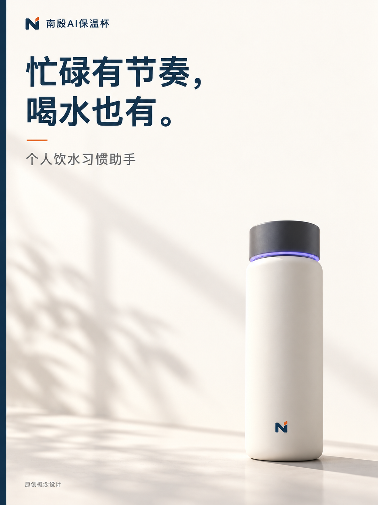
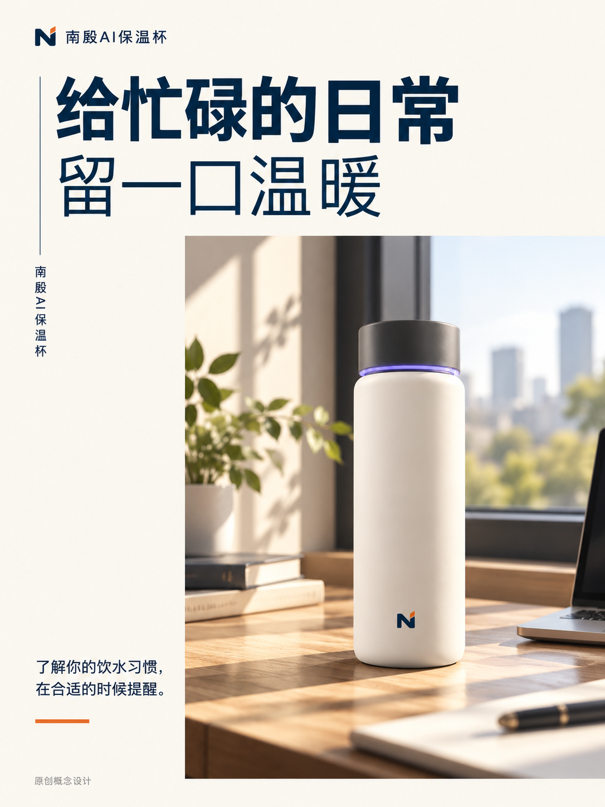
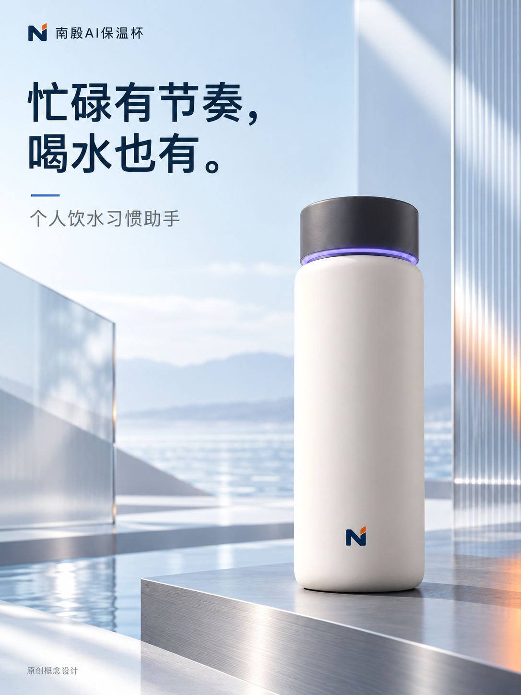
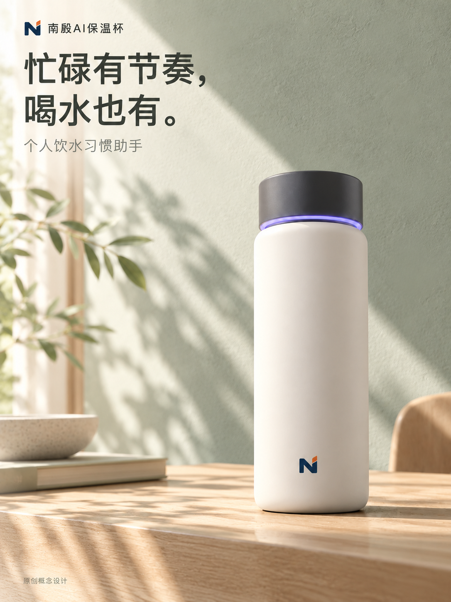
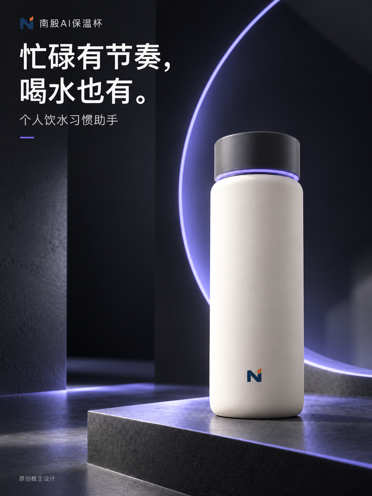

# Nanyin Ecommerce Image · 南殷电商视觉工坊

把商品资料与参考图转为电商主图、详情套图、广告海报、商品精修与模特展示图。一套安装包包含 **1 个总控＋5 个专业技能＋共享执行器**。

由 [南殷居士](AUTHOR.md) 设计、编排和维护。公众号 **南殷用AI** · [官网](https://nanyinai.vip/) · [GitHub](https://github.com/nicolasyxw999) · [MIT License](LICENSE)。

## 成功案例展示

以下为使用本套件实际生成的「南殷AI保温杯」原创概念图，展示商品摄影、系列构图与主题视觉的成图效果。点击图片可查看原图。

### 同一商品，三种构图

保留暖白杯身、深色杯盖、紫色光环与 N 标识，分别用留白、杂志版式和微距传达不同视觉重点。

| 极简留白 · 主视觉 | 杂志编辑 · 办公场景 | 巨物微距 · 细节表现 |
|:---:|:---:|:---:|
|  |  |  |

### 同一商品，三种主题风格

保持商品的基本外观与品牌标识，分别探索清透科技、自然居家与深色科技方向。

| 雾蓝科技 | 鼠尾草绿 | 石墨紫光 |
|:---:|:---:|:---:|
|  |  |  |

这些图片为 AI 生成的概念视觉，图中文字及功能表达不代表在售产品承诺；跨图细节不等于工业精密一致。已查看主要标题、杯型、标识与构图，未验证真实硬件、App 功能或平台审核。[案例来源与检查说明](docs/showcase.md)。

## 能做什么

| 技能 | 用途 |
|---|---|
| `nanyin-ecommerce-image` | 整理商品资料，协调跨场景、多平台、多 SKU 图片任务 |
| `nanyin-ecommerce-photography` | 白底图、棚拍、微距、场景摄影与多角度展示 |
| `nanyin-ecommerce-detail` | 套图、卖点模块、规格说明与详情长图 |
| `nanyin-ecommerce-marketing` | 广告 KV、促销海报、直播静态素材与社媒图 |
| `nanyin-ecommerce-edit` | 已有底图精修、换背景、改色、改字与替换 Logo |
| `nanyin-ecommerce-consistency` | 模特换装、服饰配件展示、跨图人物与商品一致性 |

默认使用 Codex 当前会话真实可用的 `image_gen`，无需另配 API Key；也可明确选择千问或火山引擎。仓库不包含模型、账号或额度。开源许可证不意味着模型调用免费。

商品参数只采用本次提供的事实；未知参数省略。系列保持商品与品牌一致，逐张安排构图；作者品牌不会自动出现在客户商品图中。Python 负责计划、文件、任务状态、续跑和长图导出，图像理解、生成与视觉判断由智能体及真实工具完成。

## 安装

下载 [Release ZIP](https://github.com/nicolasyxw999/nanyin-ecommerce-image/releases) 并解压，或克隆仓库：

```bash
git clone https://github.com/nicolasyxw999/nanyin-ecommerce-image.git
cd nanyin-ecommerce-image
python3 install.py --dest ~/.codex/skills
```

**请执行安装器，不要只把仓库根目录或总控文件夹放入 skills。** 安装后应有六个同级技能文件夹和一个 `nanyin-ecommerce-shared` 资源目录。安装器会转换共享引用，并拒绝覆盖已有目录；升级前自行备份并检查本地修改。

安装器只需 Python 标准库。使用本地任务记录、图像校验、长图导出和测试时，需 Python 3.10+、macOS／Linux（使用 POSIX 文件锁）及依赖：

```bash
python3 -m venv .venv
source .venv/bin/activate
python -m pip install -r requirements.txt
```

在同一环境执行共享 Python 命令；`requests` 仅外部服务调用需要。Windows 可使用 WSL，原生 Windows 执行器未验证。内置生成工具由宿主提供；缺少工具时应明确说明，可按用户要求交付方案与提示词。

安装后开启能重新发现技能的新会话，再输入：

```text
$nanyin-ecommerce-image
根据我上传的商品图制作一套电商图片。
先整理真实信息并规划图位，暂时不要生成。
```

## 准备哪些资料

上传商品正面图；方便时补充背面、标签与细节图。没有实物时，明确是否允许设计概念款。也可复制下列清单，**不必填满**：

```text
品牌和商品名称：
已确认的规格、SKU、真实卖点及依据：
商品图／Logo／人物参考：
无实物时是否允许原创概念款：
必须保留的结构、颜色、标识：
目标人群与使用场景：可推荐
品牌配色、文案与禁用内容：
平台与用途：主图／详情／广告等
图片数量、比例、文字语言：可推荐
执行方式：先方案／资料足够后直接制作整套
```

技能复用已给资料，只补问阻塞信息；自动推荐用于风格、图数和构图，不用于补造容量、材料、性能、认证、销量或价格。

## 常用指令

**制作整套：**

```text
沿用上传的商品图和已确认资料，图数和视觉方向你推荐。
资料足够后连续完成整套，每张独立成图，不用逐张确认。
交付原图、提示词、文件清单和实际检查结果。
```

**局部修改：**

```text
$nanyin-ecommerce-edit
只更换这张商品图的背景，保留商品结构、颜色、Logo 和现有文字。
保存为新文件。
```

**只要方案与提示词：**

```text
$nanyin-ecommerce-image
先做逐图规划与完整提示词，不生成图片。
中文提示词和英文提示词分文件，画面文字均为中文。
```

详细步骤与任务恢复见 [使用指南](docs/usage-guide.md)。与 [nanyin-ecommerce-kv](https://github.com/nicolasyxw999/nanyin-ecommerce-kv) 相比，KV 专注系列海报及独立中英文提示词；本套件覆盖多个专业场景及共享任务记录，可同时安装。

## 验证与开发

```bash
python -m unittest discover -s tests -v
python scripts/build_release.py
```

当前发布的本地测试与安装检查见 [验证报告](docs/verification.md)。自动测试使用模拟响应与测试图片，不能证明真实模型效果、接口连通性、OCR 或平台审核通过。

源码入口为 `skills/`，共享协议、模板和执行器位于 `shared/`。发布包不包含客户素材、开发机配置、会话日志或原始参考库。[来源与实现说明](来源与实现说明.md) 保留分发范围与依赖说明。问题反馈可使用 [Issues](https://github.com/nicolasyxw999/nanyin-ecommerce-image/issues)，提交前删除客户与账户信息。

## 许可与使用范围

仓库代码、技能说明和模板采用 [MIT](LICENSE)，允许在保留许可证与版权声明的条件下使用、修改和分发。第三方服务、商标、素材、肖像与模型输出各自遵守相关授权和条款。生成与保存图片的指令不自动授权上传店铺或对外发布。
